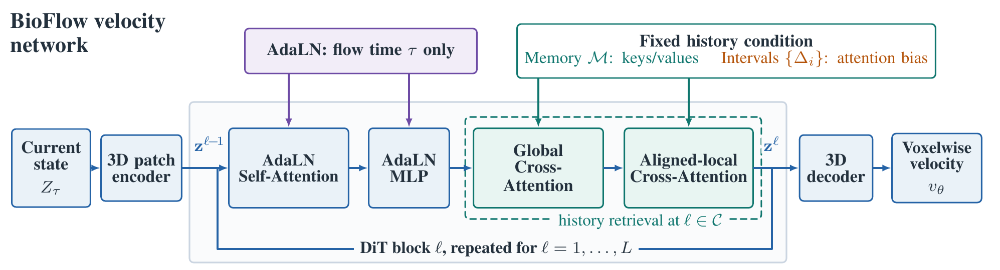

# BioFlow

**BioFlow: Conditional Flow Matching for Patient-Specific 3D Medical Image Forecasting from Irregular Histories**

Official repository for the BioFlow paper.

> **Status:** the code and evaluation protocols are being cleaned up and will be released here. Watch or star the repository to be notified.

## Overview

Given sparse 3D scans acquired at irregular clinical intervals, BioFlow forecasts a patient's 3D volume at a specified future acquisition time.

Longitudinal scans of one patient share substantial anatomy, so repeating the latest scan is already a strong predictor, but it cannot capture patient-specific change. Existing multi-scan continuous-time flow models do not explicitly keep the full visit history as a separate, fixed condition: the closest prior approach evolves the entire scan stack and interpolates acquisition timestamps with the numerical flow variable, which entangles clinical intervals with integration progress.

BioFlow is a multi-scan 3D conditional flow-matching framework that separates numerical flow time from clinical observation time:

- **One evolving prediction state.** Only the forecast volume is integrated along numerical flow time.
- **A fixed, visit-resolved history.** Every observed scan stays available unchanged, together with its interval to the target time, at each velocity evaluation.
- **Interval-aware initialization.** Target-relative acquisition intervals weight a blend of the observed scans that initializes the prediction state.
- **Global and aligned-local cross-attention.** At selected transformer blocks, the velocity network retrieves spatial information from the history, with the target-relative intervals entering as a learned attention bias.

The formulation does not require a disease-specific progression axis and does not assume monotonic temporal evolution.

  

<em>BioFlow velocity network. The fixed visit memory provides cross-attention keys and values; numerical flow time conditions only the evolving state.</em>

## Benchmarks

BioFlow is evaluated on three controlled synthetic benchmarks and three clinical cohorts, using SSIM, PSNR, NRMSE and MSE.

**Controlled synthetic benchmarks**

| Benchmark | What it tests |
| --- | --- |
| Patient-specific cyclic motion | Inferring temporal phase from sparse observations |
| Nonlinear 3D dynamics and morphology change | Using the history beyond the latest scan |
| Localized motion, size and intensity change | Jointly capturing spatial, morphological and intensity change |

**Clinical cohorts**

| Dataset | Modality | Temporal scale |
| --- | --- | --- |
| [ISLES](https://isles-24.grand-challenge.org/) | Perfusion CT, acute ischemic stroke | Seconds |
| [ACDC](https://www.creatis.insa-lyon.fr/Challenge/acdc/) | Cardiac cine MRI | Within a cardiac cycle |
| [LUMIERE](https://doi.org/10.1038/s41597-022-01881-7) | Longitudinal glioblastoma MRI | Weeks |

ISLES and ACDC are regularly sampled in their original form; sparse, irregular histories are built by randomly subsampling their temporal frames. LUMIERE keeps its naturally sparse and non-uniform clinical follow-up intervals.

All three clinical datasets are publicly released by their original authors. This repository does not redistribute any imaging data; please obtain the datasets from the links above and follow their terms of use.

## Citation

A BibTeX entry will be added once the paper is published.

## Contact

For questions, please open an issue in this repository.
